<a href="https://aman.wiki"></a>

<p align="center">
  <a href="https://aman.wiki"></a>
  <a href="https://resume.aman.wiki"></a>
  <a href="https://www.linkedin.com/in/jn-aman"></a>
  <a href="https://blog.aman.wiki"></a>
  <a href="mailto:jain.aman1497@gmail.com"></a>
</p>

```ts
const aman = {
  role:        "Staff Software Engineer @ Varonis",
  previously:  ["SentinelOne", "Borneo (acquired by Atlassian)", "Safe Security"],
  focus:       ["distributed systems", "platform engineering", "multi-tenant SaaS", "LLM agents"],
  leadership:  "mentored 20 engineers, led a 20-engineer platform redesign",
  certified:   ["8x AWS", "Claude Certified Architect - Professional"],
  askMeAbout:  ["AWS", "Kubernetes", "Kafka", "multi-tenancy", "agentic workflows"],
  writing:     "https://blog.aman.wiki",
};
```

### ⚡ Impact


### 🛠️ Stack

<p align="center">
  <br />
  <br />
  
</p>

### 🏅 Certified

<p align="center">
  <a href="https://www.credly.com/badges/e3686b7a-46da-4f98-9814-929dd2bec2d6/public_url"></a>
  <a href="https://www.credly.com/badges/60ef56ba-a5c4-4f30-abcd-d2c8f7542301/public_url"></a>
  <a href="https://www.credly.com/badges/3a3fee84-bcdd-4859-9c45-196fefd4e966/public_url"></a>
  <a href="https://www.credly.com/badges/e20029fc-816f-489c-ad36-42854debb26a/public_url"></a>
  <a href="https://www.credly.com/badges/b52070e6-1b72-4ee5-8016-0e934ff11989/public_url"></a>
  <br />
  <a href="https://www.credly.com/badges/028e1364-4f5f-4aab-9cc7-440eebc12b68/public_url"></a>
  <a href="https://www.credly.com/badges/ede7aa40-fd7f-43a2-9d7c-961f2e5a572c/public_url"></a>
  <a href="https://www.credly.com/badges/676c059b-ca7b-4a70-8ed9-70232857cb47/public_url"></a>
  <a href="https://www.credly.com/badges/c79297bc-8948-411a-aa02-530f5cf53a77/public_url"></a>
  <a href="https://www.credly.com/badges/bf3054ba-eedf-4244-979d-83c2a48f6252/public_url"></a>
</p>

<p align="center"><sub>🏆 <b>Star Performer - Trust</b> · SentinelOne 2024 &nbsp;&nbsp;|&nbsp;&nbsp; <b>Star Performer of the Year</b> · Safe Security 2023 &nbsp;&nbsp;|&nbsp;&nbsp; <b>Safe SuperStar</b> x3 · 2022</sub></p>

### 🚧 Building

| Project | About |
|:--|:--|
| 📰 **[ByteBrief](https://bytebrief.ai)** | AI-powered tech news, aggregated and summarized for **~10K daily readers** |
| 🌐 **[is-my.app](https://is-my.app)** | Free subdomains for developers, **2,000+** registered |
| 🗺️ **[SafePath](https://safepath.aman.wiki)** | Safety-aware routing for Delhi, from crime data with K-Means and route scoring |
| 📦 **[dummy-data-generator](https://www.npmjs.com/package/dummy-data-generator)** | Random test data for JS, **15,000+ downloads** on npm |
| 🤝 **Open source** | Fixes and improvements in **Tailscale**, **Sequelize** and **AWS CDK** |

### 📊 Activity

<p align="center">
  <picture>
    <source media="(prefers-color-scheme: dark)" srcset="https://github-readme-stats.vercel.app/api?username=jn-aman&show_icons=true&include_all_commits=true&hide_rank=true&hide_border=true&theme=tokyonight&bg_color=00000000" />
    
  </picture>
  <picture>
    <source media="(prefers-color-scheme: dark)" srcset="https://streak-stats.demolab.com?user=jn-aman&theme=tokyonight&hide_border=true&background=00000000" />
    
  </picture>
</p>

### ✍️ Writing

<!-- BLOG-POST-LIST:START -->
- [Keeping Your Docker Containers Fresh: Auto-Updating with Watchtower and Docker Compose](https://medium.com/@jn-aman/keeping-your-docker-containers-fresh-auto-updating-with-watchtower-and-docker-compose-85a0a54bfb23?source=rss-ea74297c1ece------2)
- [Breaking Up with AmazonMQ: Slashing Costs by 90% with a Self-Managed RabbitMQ Cluster](https://medium.com/@jn-aman/breaking-up-with-amazonmq-slashing-costs-by-90-with-a-self-managed-rabbitmq-cluster-51d1258612c1?source=rss-ea74297c1ece------2)
- [The Git Config You Didn’t Know You Needed](https://medium.com/@jn-aman/the-git-config-you-didnt-know-you-needed-0b4ef4bcb6f5?source=rss-ea74297c1ece------2)
- [How Unleash enhanced our troubleshooting experience by 100x](https://medium.com/safe-engineering/how-unleash-enhanced-our-troubleshooting-experience-by-100x-e0c82b6df825?source=rss-ea74297c1ece------2)
- [JavaScript: Some Cool Console Methods in 2022.](https://medium.com/@jn-aman/javascript-some-cool-console-methods-in-2022-49c86dd25b0b?source=rss-ea74297c1ece------2)
<!-- BLOG-POST-LIST:END -->

<p align="right"><a href="https://blog.aman.wiki"><sub>All posts →</sub></a></p>
